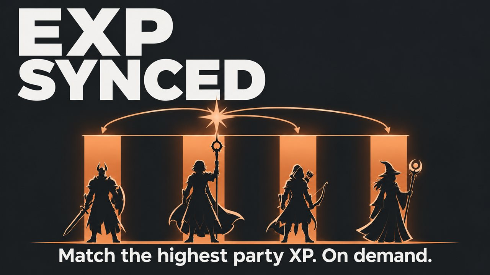

# EXP Synced

One click in the Mod Configuration Menu raises the experience of every party member to the highest in the party.

## What it does

Party members who fell behind in experience catch up with one click:

- A **Sync now** button in the Mod Configuration Menu raises the experience of every party member to the highest
  total in the party.
- Nobody loses experience.
- The party is your active party; in multiplayer, the characters of every player. Companions in camp and summons
  stay as they are.
- The game then shows the level-up button as usual: you choose the level-up yourself.

## Screenshots

## How to install

1. Install [Norbyte's Script Extender](https://github.com/Norbyte/bg3se). It updates itself.
2. Install the [Mod Configuration Menu](https://github.com/KintaroModding/bg3_mcm/releases/latest), version 1.41 or
   later. The official Mod Configuration Menu 1.41 or later works too; keep only one of them.
3. Download `bg3_expsynced.pak` from the latest release on GitHub.
4. Copy it to `%LOCALAPPDATA%\Larian Studios\Baldur's Gate 3\Mods`.
5. Enable **EXP Synced** in your mod manager (BG3 Mod Manager or the in-game mod manager), below the Mod
   Configuration Menu.

To update the mod, replace the `.pak` with the one from the new release. To remove it, disable it in the mod manager
and delete the `.pak`. Saves made with the mod can then show a warning about a missing mod.

## How to use

- Open the Mod Configuration Menu (main menu, Esc menu, or the Insert key) and select **EXP Synced**.
- Click **Sync now**. The text next to the button says who got experience, for example "Raised Gale and Wyll to
  6,500 XP.", or "Everyone already has 6,500 XP.".
- The game adds the experience a moment later. A click before that says "Still syncing. Try again in a moment."
- In the main menu the button only asks you to load a savegame.

## Compatibility

- Game version: Patch 8
- The mod changes no game files: it gives experience with the game's own call, so it works with other mods.
- Mods that multiply experience gains (for example the experience multiplier of Level Unlocked) can multiply the
  synced experience too. Set such a multiplier to 1 before you sync.

## Known issues

- Multiplayer is not tested yet.

## How to build

Anyone can build this mod from its source code and check that the download matches it.

1. Install the tools: Windows PowerShell 5.1 (part of Windows) and [LSLib](https://github.com/Norbyte/lslib/releases)
   v1.20.4. Put LSLib into a folder `_tools\lslib\` above the repository, or set `BG3_TOOLS` to the folder that holds
   `lslib\`.
2. Build it: `powershell -ExecutionPolicy Bypass -File .\build.ps1`
3. Find the file: `dist\bg3_expsynced.pak`

The offline tests need Python 3 with lupa: `python -m pip install lupa`, then `python tests\run_tests.py`.

## Credits

Made by Kintaro. MIT license: you may use, change and share this mod.
